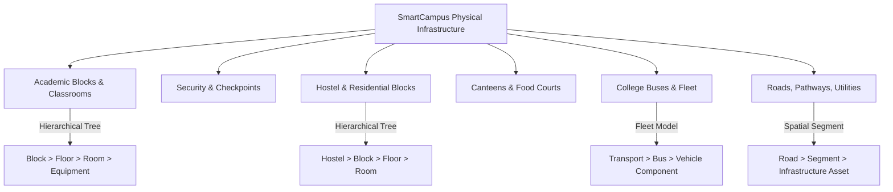

# SmartCampus: Campus Location Management Documentation

## 1. Overview & Architecture

The **Campus Location Management Subsystem** provides a unified, extensible, and hierarchical spatial directory covering all physical and operational campus areas. Rather than forcing every location into an academic "Building > Floor > Room" model, the system supports heterogeneous structures, including standalone security checkpoints, vehicle components, roadway segments, outdoor grounds, and utility sub-stations.



---

## 2. Supported Campus Facility Categories

The system supports all 15 operational categories specified by institutional standards:

| Category Key | Display Category | Example Hierarchy / Structure |
|---|---|---|
| `MAIN_GATE_SECURITY` | Main Gate & Security Checkpoints | Entrance Perimeter > Main Gate > Checkpoint 1 |
| `ACADEMIC_BLOCK` | Academic Blocks & Classrooms | Science Block > 2nd Floor > Physics Lab 204 |
| `LABORATORY` | Laboratories & Research Facilities | Mechanical Workshop > CNC Lab > Machine #2 |
| `FACULTY_ADMIN_OFFICE` | Faculty & Admin Offices | Admin Building > Ground Floor > Dean's Office |
| `HOSTEL_RESIDENTIAL` | Hostels & Residential Blocks | Kaveri Boys Hostel > Block B > 3rd Floor > Room 312 |
| `CANTEEN_CAFETERIA` | Canteens & Food Courts | Central Canteen > Main Kitchen > Cold Storage Unit |
| `LIBRARY_AUDITORIUM` | Library & Auditoriums | Central Library > 2nd Floor > Reference Cubicle 04 |
| `PARKING` | Car & Two-Wheeler Parking | Parking Zone North > Slot B-12 |
| `TRANSPORT_BUS` | College Buses & Transport | Fleet Depot > Bus #14 > Air Braking Subsystem |
| `ROAD_PATHWAY` | Roads, Pathways & Pedestrian Crossings | North Ring Road > Segment 3 > Pedestrian Crossing |
| `SPORTS_GROUND` | Grounds & Sports Facilities | Sports Complex > Cricket Ground > Floodlight Tower 3 |
| `TOILET_WATER` | Toilets & Drinking Water | Academic Block 1 > Floor 2 > West Wing Restroom |
| `GARDEN_OUTDOOR` | Gardens & Landscaping | Quadrangle Garden > Fountain & Drip Irrigation Pump |
| `UTILITY_ELECTRICAL` | Electrical & Utility Sub-stations | Substation #2 > Transformer Room > High Voltage Panel 4 |
| `OTHER_FACILITY` | Other Campus Facilities | Campus Medical Center > Triage Ward 1 |

---

## 3. Data Model & Indexing Rules

The MongoDB `Location` schema provides both hierarchical tree capabilities and 100% backward compatibility for legacy queries:

```typescript
// server/src/models/Location.ts
export interface ILocation extends Document {
  code: string;                          // Unique uppercase alphanumeric code (e.g. SEC-GATE-01)
  name: string;                          // Display name
  locationType: CampusLocationType;      // One of 15 supported categories
  structureType: LocationStructureType;  // ROOM_BASED | SEGMENT_BASED | VEHICLE_BASED | ZONE_BASED | STANDALONE
  parentLocation?: Types.ObjectId;       // Parent node in the tree hierarchy
  fullPath: string;                      // Computed path (e.g. Kaveri Hostel > Block B > Room 312)
  zone?: string;                         // Geographic campus quadrant
  isActive: boolean;                     // Operational flag
  // Backward compatibility fields:
  buildingName?: string;
  floor?: string;
  roomNumber?: string;
}
```

### Database Indexes

1. **Unique Code Index**: `{ code: 1 }`, `unique: true`, `sparse: true`
2. **Category & Status Index**: `{ locationType: 1, isActive: 1 }`
3. **Parent Hierarchy Index**: `{ parentLocation: 1 }`
4. **Legacy Compound Index with Partial Filter**:
   ```javascript
   { buildingName: 1, floor: 1, roomNumber: 1 },
   {
     unique: true,
     partialFilterExpression: {
       buildingName: { $exists: true, $type: 'string', $gt: '' },
       floor: { $exists: true, $type: 'string', $gt: '' },
       roomNumber: { $exists: true, $type: 'string', $gt: '' }
     }
   }
   ```
   *Rationale:* This prevents outdoor or bus locations (where floor/room are null) from causing E11000 duplicate index conflicts.

---

## 4. Deletion Protection Architecture

To prevent accidental data loss and orphan records, the `DELETE /api/locations/:id` endpoint enforces strict validation before removing any location:

1. **Child Hierarchy Check**: If any child locations reference `parentLocation: id`, deletion is rejected with `400 Bad Request: Cannot delete location: It has child locations dependent on it in the hierarchy tree.`
2. **Active Maintenance / Complaint Check**: If any complaint has `status: ['Reported', 'Assigned', 'In Progress', 'Accepted', 'Escalated']` referencing the location, deletion is blocked: `400 Bad Request: Cannot delete location: Active unresolved complaints are mapped to this location.`
3. **Asset Registration Check**: If physical equipment in `Asset` points to this location, deletion is blocked: `400 Bad Request: Cannot delete location: Campus assets are installed at this location.`

---

## 5. Administrative UI Operations

In the Administrator Command Center, the **Campus Locations & Facility Zones** tab provides:
- **Hierarchical Tree Browsing**: Filter by category, status, and zone.
- **Location Creator**: Create root facilities or nested nodes with automatic path calculation.
- **Active/Inactive Toggling**: Safely deactivate facilities undergoing renovation without deleting historical tickets.
- **Live Complaint Inspector**: View active, pending, and resolved maintenance issues assigned directly to the chosen location.
