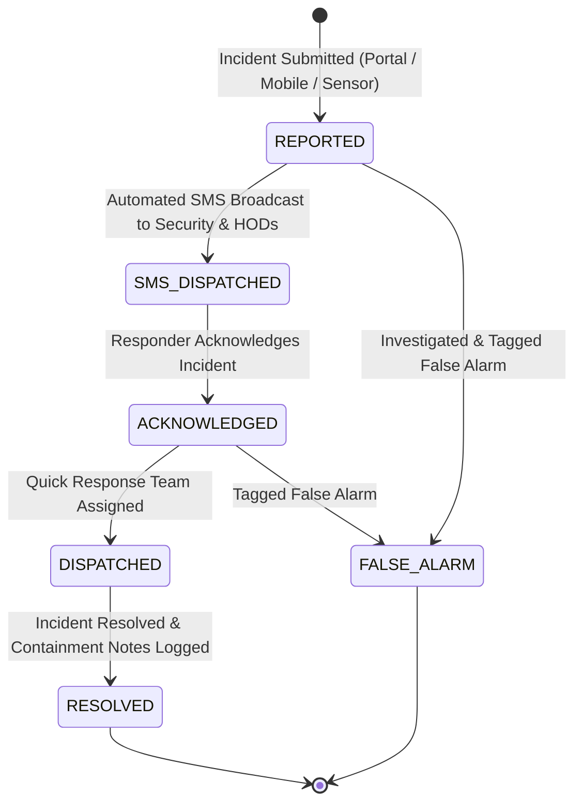

# SmartCampus: Emergency Response & Crisis Management Workflow

## 1. Overview & Policy Distinction

SmartCampus establishes a clear policy separation between routine facility maintenance and high-risk life safety emergencies:

| Dimension | Routine Complaint | Urgent Facility Hazard | Life-Threatening Emergency / SOS |
|---|---|---|---|
| **Example** | Flickering tube light, loose door handle | Main pipe burst flooding lab, elevator trapped | Women safety issue, active electrical fire, structural collapse |
| **Priority** | Low / Medium | High | CRITICAL / SOS |
| **Routing** | Assigned to specific department technician queue | Alert routed to department foreman | Automated SMS broadcast to emergency responders & HODs |
| **Response SLA** | 24 - 48 hours | 2 - 4 hours | Immediate (<15 minutes) |
| **Real-time Alerting** | In-app dashboard update | In-app badge notification | Persistent visual siren on Admin Emergency Command Center |

---

## 2. Emergency Incident Lifecycle State Machine

### Lifecycle Transitions & Audit Logging

Every state transition records an immutable audit entry in `timeline`:
1. **`INCIDENT_REPORTED`**: Timestamp, reporter identity (or masked anonymous flag), location, and initial emergency severity.
2. **`SMS_BROADCAST`**: Recipient telephone numbers (masked), provider dispatch timestamps, and message tracking IDs.
3. **`INCIDENT_ACKNOWLEDGED`**: Responder name, acknowledgment timestamp, and containment ETA.
4. **`TEAM_ASSIGNED`**: Assigned quick response unit (e.g. Electrical Emergency Team, Campus Security Unit).
5. **`INCIDENT_RESOLVED`**: Resolution timestamp, resolution summary notes, and root cause notes.

---

## 3. High-Risk Women Safety & SOS Protocol

When an incident or complaint involves **Women Safety** or **High-Risk Personal Safety**:
- System triggers the **Dedicated Safety Alert Protocol**.
- Automated notifications route immediately to designated emergency contact numbers:
  - **HOD & Safety Coordinators**: `+91 9952911217`, `+91 6382373918`
- Exact location details (Building, Zone, Room, or GPS Landmark) are dispatched via SMS.
- Anonymous reporting is fully honored: the reporter's phone number and identity remain protected from unauthorized viewers while emergency teams are alerted to the incident location.

---

## 4. Emergency Dashboard Operational Controls

Authorized administrative and security personnel access the **Emergency & SOS Dispatch** tab:
1. **Incident Feed**: Real-time listing with severity indicators (Red/Pulsing for Critical, Amber for High).
2. **Acknowledge Modal**: One-click acknowledgment stopping escalation timers.
3. **Assign Team Drawer**: Direct assignment of response squads with operational remarks.
4. **Resolution Modal**: Recording comprehensive incident post-mortem notes.
5. **SMS Delivery Log Inspector**: Viewing provider message status (`QUEUED`, `SENT`, `DELIVERED`, `FAILED`) per recipient.
