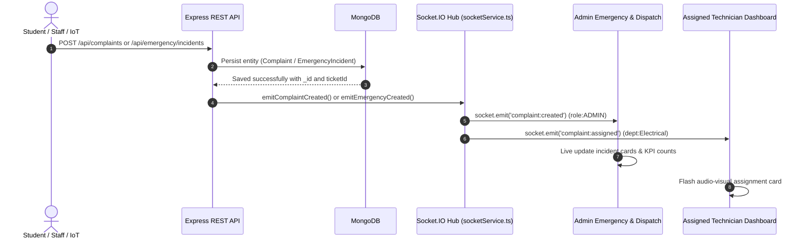

# SmartCampus: Real-Time Notification & WebSocket Architecture

## 1. Overview

SmartCampus utilizes **Socket.IO** for low-latency, bidirectional event synchronization between the Express backend and Vite React client. Real-time notifications ensure that whenever an issue is reported, a work order is dispatched, or an emergency alarm is raised, dashboards reflect the changes instantaneously without requiring manual page reloads or polling.



---

## 2. Authentication & Handshake Security

WebSocket connections are authenticated during the initial handshake using the existing JWT mechanism:

```typescript
// server/src/services/socketService.ts
io.use((socket, next) => {
  const token = socket.handshake.auth?.token || socket.handshake.headers?.authorization;
  if (!token) {
    return next(new Error('Authentication required for real-time socket connection.'));
  }
  try {
    const decoded = jwt.verify(cleanToken, process.env.JWT_SECRET) as any;
    socket.data.user = decoded;
    next();
  } catch (err) {
    return next(new Error('Invalid or expired authentication session.'));
  }
});
```

### Room Isolation Matrix

To prevent unauthorized access to sensitive records, sockets join secure rooms based strictly on verified token claims:

| Room Pattern | Who Joins | Events Broadcasted |
|---|---|---|
| `user:<userId>` | The specific authenticated user | Direct status changes on tickets reported by this user |
| `role:ADMIN` | Users with role `ADMIN` | All campus complaints, asset alarms, emergency incidents |
| `role:STAFF` | All verified maintenance technicians | General maintenance alerts |
| `dept:<departmentName>` | Technicians assigned to that department | New tickets routed to their department (e.g. `dept:Electrical`) |
| `emergency:responders` | Campus security, HODs, coordinators | High-risk alerts, SOS alarms, status updates |

---

## 3. Privacy & Anonymous Reporter Protection

When a user submits an issue anonymously (`isAnonymous: true`), the backend strips all personally identifiable information (PII) before emitting events across rooms:

```typescript
export const emitComplaintCreated = (complaint: any) => {
  const sanitized = {
    ...complaint,
    reportedBy: complaint.isAnonymous ? undefined : complaint.reportedBy,
    reportedByName: complaint.isAnonymous ? 'Anonymous Reporter' : complaint.reportedByName,
    reporterPhone: undefined,
  };
  io.to('role:ADMIN').emit('complaint:created', sanitized);
};
```

---

## 4. Reconnection & Stale State Prevention

The client socket service ([socket.ts](file:///c:/Users/lenovo/OneDrive/Desktop/Mini%20Project/client/src/services/socket.ts)) includes:
- **Exponential Reconnection**: Retries with a 2-second backoff upon connection loss.
- **State Refetch on Reconnect**: When the socket reconnects after network disconnection, `connect` triggers `fetchAdminData()` or `fetchComplaints()` to guarantee no events were missed during downtime.
- **Authoritative REST Backup**: Sockets only broadcast event notifications; the persistent database accessed via REST endpoints remains the single source of truth.
