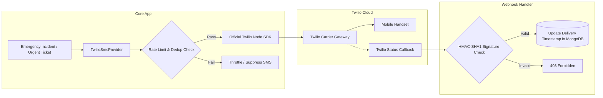

# SmartCampus: Production-Grade Twilio SMS Setup & Testing Guide

## 1. Overview & Architectural Design

SmartCampus provides a carrier-grade server-side Twilio SMS integration implemented in [`twilioSmsService.ts`](file:///c:/Users/lenovo/OneDrive/Desktop/Mini%20Project/server/src/services/twilioSmsService.ts). 

### Key Engineering Guardrails
1. **Zero Credential Exposure**: Twilio credentials are read strictly from backend environment variables and are never bundled into client applications.
2. **Number Privacy / Masking**: Logs and audit records mask telephone numbers (e.g. `+91 99529*****`), preventing accidental privacy leakage in log collectors.
3. **Truthful Status Reporting**: When credentials are missing, the system reports `UNAVAILABLE_NO_GATEWAY` or safe `SIMULATED_DEV`. It never fabricates successful SMS transmission.
4. **Duplicate Prevention**: Identical notification messages to the same telephone number within a 5-minute sliding window are blocked automatically.
5. **Rate Limiting**: To prevent cellular billing exhaustion or denial-of-service spam, outbound messages are capped at **10 SMS/hour per recipient** and **100 SMS/hour globally**.
6. **Delivery Webhook Signature Verification**: Twilio delivery status callbacks are validated using Twilio's HMAC-SHA1 signature (`X-Twilio-Signature`) to block spoofed webhooks.



---

## 2. Environment Variables Configuration

In `server/.env`:

```env
# Twilio Account SID & Auth Token (From Twilio Console Dashboard)
TWILIO_ACCOUNT_SID=ACXXXXXXXXXXXXXXXXXXXXXXXXXXXXXXXX
TWILIO_AUTH_TOKEN=your_auth_token_here

# Outbound Sender Configuration (Choose either Phone Number OR Messaging Service SID)
TWILIO_PHONE_NUMBER=+12025550199
# OR
# TWILIO_MESSAGING_SERVICE_SID=MGXXXXXXXXXXXXXXXXXXXXXXXXXXXXXXXX

# Public Status Callback Endpoint for Webhooks (Optional for local dev)
TWILIO_STATUS_CALLBACK_URL=https://yourcampusdomain.edu/api/emergency/twilio/status-callback
```

---

## 3. Webhook Delivery Status Callbacks

Twilio posts asynchronous delivery events (`queued`, `sent`, `delivered`, `undelivered`, `failed`) to:
`POST /api/emergency/twilio/status-callback`

### Signature Verification Implementation
The webhook handler verifies authenticity using Twilio's signature validator:

```typescript
const isValid = validateTwilioSignature(
  process.env.TWILIO_AUTH_TOKEN || '',
  signature,
  fullCallbackUrl,
  req.body
);
if (!isValid) {
  return res.status(403).json({ success: false, message: 'Invalid webhook signature.' });
}
```

---

## 4. Testing Modes & Verification

### Mode A: Automated Testing via `MockSmsProvider` (Zero Cellular Charges)
During automated tests, the application injects a `MockSmsProvider`:
- Does not contact Twilio servers or make network requests.
- Returns realistic message IDs (`SM_MOCK_...`).
- Validates rate-limiting, deduplication, E.164 normalization, and signature checking.
- Execute with:
  ```bash
  npm run test:campus
  ```

### Mode B: Local Development Simulation Mode
When `TWILIO_ACCOUNT_SID` is blank in `server/.env` and `NODE_ENV=development`:
- The application logs formatted SMS dispatches to the server console.
- Returns status `SIMULATED_DEV`.
- Prevents development halts while testing UI flows.

### Mode C: Real Twilio Cellular Testing
To verify actual SMS delivery to physical devices:
1. Obtain a Twilio Account SID, Auth Token, and Twilio phone number.
2. In Twilio Trial accounts, ensure recipient phone numbers (`+919952911217`, `+916382373918`) are added to **Verified Caller IDs** in the Twilio Console.
3. Configure `TWILIO_ACCOUNT_SID`, `TWILIO_AUTH_TOKEN`, and `TWILIO_PHONE_NUMBER` in `server/.env`.
4. Trigger an Emergency Alert from the Admin Emergency Dashboard (`Emergency & SOS` tab) or submit a complaint with Priority `Urgent`.
5. Observe the inbound SMS on the handset and the status indicator update in the emergency incident feed.
